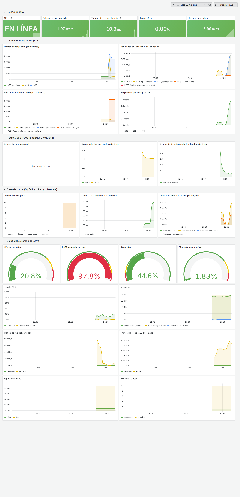

# Monitoreo (observabilidad) de TécnicoYa API

Cómo saber qué pasa dentro de la API mientras está en funcionamiento. Cubre los tres temas de la clase:

| Tema | Qué se usa | Dónde |
|---|---|---|
| **1. Logs** | Logback + SLF4J | `src/main/resources/logback-spring.xml` |
| Niveles de log | TRACE < DEBUG < INFO < WARN < ERROR, perfil `dev` y cambio en caliente con `/actuator/loggers` | `logback-spring.xml`, `application.properties` |
| Logs estructurados (JSON) | `StructuredLogEncoder` de Spring Boot, formato ECS de Elastic | `logs/tecnicoya-api.json` |
| Manejo de excepciones | `GlobalExceptionHandler` + id de cada petición (`X-Request-Id`) | `exception/`, `monitoreo/IdPeticionFilter.java` |
| **2. Rendimiento (APM)** | Spring Boot Actuator + Micrometer | `/actuator/metrics`, `/actuator/prometheus` |
| Métricas APM | `http.server.requests`: tiempos (p50/p95/p99), peticiones/s y errores por endpoint | `application.properties` |
| Rastreo de errores backend/frontend | Errores 5xx por endpoint, `logback.events`, `POST /api/monitoreo/errores-frontend` | `monitoreo/RegistroErroresFrontend.java`, `tecnicoya-web/src/shared/lib/reportar-errores.ts` |
| Monitoreo de la base de datos | Pool Hikari, estadísticas de Hibernate, log de consultas lentas, health `db` | `application.properties` |
| **3. Salud del sistema operativo** | Micrometer + OSHI | `monitoreo/MetricasSistemaOperativo.java` |
| CPU y memoria | `system.cpu.usage`, `process.cpu.usage`, `sistema.memoria.*`, `jvm.memory.*` | |
| Espacio en disco | `disk.free`, `disk.total`, health `diskSpace` | |
| Uso de red | `sistema.red.trafico`, `sistema.red.errores`, `tomcat.global.sent/received` | |
| **Visualización y alertas** | Prometheus + Grafana (Docker) | `monitoreo/` |



---

## 1. Logs

### Destinos

| Archivo | Formato | Contenido | Rotación |
|---|---|---|---|
| Consola | Texto con colores | Todo | — |
| `logs/tecnicoya-api.log` | Texto | Log general | Diaria o 10 MB, 30 días |
| `logs/auditoria.log` | Texto | Solo seguridad (logins, accesos denegados, operaciones) | Diaria, 90 días |
| `logs/tecnicoya-api.json` | **JSON (ECS)** | Todo, incluida la auditoría | Diaria o 10 MB, 30 días |

### Log estructurado (JSON)

Cada línea es un objeto JSON con campos separados. Herramientas como Kibana, Grafana Loki o Datadog lo filtran por
campo sin configurar patrones. Ejemplo real:

```json
{"@timestamp":"2026-11-22T03:46:52.342Z","log":{"level":"WARN","logger":"FRONTEND"},
 "process":{"pid":15588,"thread":{"name":"http-nio-8081-exec-3"}},
 "service":{"name":"tecnicoya-api","version":"0.0.1-SNAPSHOT","environment":"desarrollo"},
 "message":"ERROR_FRONTEND TypeError: x is undefined | url=http://localhost:5173/perfil | pila=at Perfil (perfil.tsx:42)\\nat App",
 "idPeticion":"cec33703-574d-4b63-aba4-a5c7b9f52e31",
 "tipo":"error","url":"http://localhost:5173/perfil","navegador":"Mozilla/5.0","ip":"0:0:0:0:0:0:0:1",
 "ecs":{"version":"8.11"}}
```

Buscar en PowerShell todos los errores, o todo lo de una petición:

```powershell
Select-String -Path logs\tecnicoya-api.json -Pattern '"level":"ERROR"'
Select-String -Path logs\tecnicoya-api.json -Pattern 'cec33703-574d-4b63-aba4-a5c7b9f52e31'
```

### Niveles de log

- Por defecto `com.tecnicoya.api` está en INFO; con el perfil `dev` pasa a DEBUG y muestra el SQL.
- **Sin reiniciar la API** (solo ADMINISTRADOR):

```http
POST /actuator/loggers/com.tecnicoya.api
Authorization: Bearer <token de administrador>
Content-Type: application/json

{"configuredLevel": "DEBUG"}
```

`GET /actuator/loggers/com.tecnicoya.api` muestra el nivel actual. Para volver: `{"configuredLevel": "INFO"}`.

### Manejo de excepciones y rastreo de una petición

- `GlobalExceptionHandler` convierte toda excepción en un JSON en español; un 500 se registra con su traza completa.
- `IdPeticionFilter` da a cada petición un id único: va en la cabecera `X-Request-Id` de la respuesta y en el campo
  `idPeticion` de cada línea del log JSON. El front-end muestra ese código cuando ocurre un error 500
  ("Código de referencia: …"): con él se encuentra el error exacto en el log.
- Los datos del cliente siempre se limpian antes de registrarse (inyección en logs, CWE-117).

---

## 2. Rendimiento de la plataforma (APM)

### Endpoints de Actuator

| Endpoint | Quién | Para qué |
|---|---|---|
| `GET /actuator/health` | Público | `{"status":"UP"}`; el administrador ve además `db`, `diskSpace` |
| `GET /actuator/metrics` | Administrador | Lista de métricas |
| `GET /actuator/metrics/{nombre}` | Administrador | Valor de una métrica, p. ej. `http.server.requests?tag=uri:/api/servicios` |
| `GET /actuator/prometheus` | Administrador o token de monitoreo | Todas las métricas para Prometheus |
| `GET /actuator/info` | Administrador | Java, sistema operativo, proceso |
| `GET/POST /actuator/loggers/{logger}` | Administrador | Ver o cambiar el nivel de log |

Seguridad (`security/MonitoreoSeguridadFilter.java`): sin token responde 401 y con un rol distinto de ADMINISTRADOR
responde 403; ambos casos quedan en la auditoría (`MONITOREO_DENEGADO`). Prometheus usa un token fijo de solo lectura
(`MONITOREO_TOKEN`), que no sirve para cambiar niveles de log. No se publican `env`, `beans`, `heapdump` ni otros
endpoints con datos internos.

### Métricas principales

| Métrica (nombre en Prometheus) | Qué mide |
|---|---|
| `http_server_requests_seconds_count/sum/bucket` | Peticiones por endpoint, método y código HTTP; tiempos y percentiles |
| `logback_events_total{level}` | Cuántos ERROR/WARN escribió la API |
| `tecnicoya_errores_frontend_total` | Errores de JavaScript reportados por el front-end |
| `hikaricp_connections_active/idle/pending/max` | Conexiones a MySQL en uso, libres y en espera |
| `hikaricp_connections_acquire_seconds` | Tiempo para obtener una conexión |
| `hibernate_query_executions_total`, `hibernate_statements_total`, `hibernate_transactions_total` | Consultas y transacciones |

Consultas lentas: Hibernate escribe en el log (logger `org.hibernate.SQL_SLOW`) cada consulta que tarda más de
`SQL_LENTA_MS` (500 ms por defecto).

### Rastreo de errores del front-end

`tecnicoya-web/src/shared/lib/reportar-errores.ts` captura los errores sin manejar (`window.onerror`, promesas
rechazadas y errores de React) y los envía a `POST /api/monitoreo/errores-frontend`. Es una ruta pública (el error
puede ocurrir antes del login), limitada a 30 reportes por minuto por IP; el navegador envía como máximo 20 por pestaña
y nunca repite el mismo error.

---

## 3. Salud del sistema operativo

| Métrica | Qué mide | Fuente |
|---|---|---|
| `system_cpu_usage` / `process_cpu_usage` | CPU del servidor / de la API (0 a 1) | Micrometer |
| `sistema_memoria_total_bytes` / `sistema_memoria_disponible_bytes` | RAM física del servidor | OSHI |
| `jvm_memory_used_bytes` / `jvm_memory_max_bytes` | Memoria de Java | Micrometer |
| `disk_free_bytes` / `disk_total_bytes` | Disco donde corre la API (logs y archivos subidos) | Micrometer |
| `sistema_red_trafico_bytes_total{sentido}` | Bytes recibidos y enviados por la red del servidor | OSHI |
| `sistema_red_errores_total` | Paquetes de red con error | OSHI |
| `tomcat_global_sent/received_bytes_total` | Tráfico HTTP de la propia API | Tomcat |

---

## Prometheus + Grafana (paneles y alertas)

Requisito: Docker Desktop en modo **contenedores Linux** (menú de Docker > *Switch to Linux containers*).

1. En el `.env` de la API defina `MONITOREO_TOKEN=<texto largo y aleatorio>` y copie el mismo valor en
   `monitoreo/prometheus/token.txt` (los dos archivos están en `.gitignore`).
2. Inicie la API en el puerto 8080.
3. En una terminal:

   ```powershell
   cd monitoreo
   docker compose up -d
   ```

4. Abra Grafana en http://localhost:3000 (usuario `admin`, clave `admin`; pide cambiarla). El panel
   **TécnicoYa API: monitoreo** se abre como inicio y tiene 5 secciones: Estado general, APM, Rastreo de errores,
   Base de datos y Sistema operativo.
5. Prometheus está en http://localhost:9090. En **Status > Targets** la API debe aparecer como `UP`, y en **Alerts**
   están las 12 alertas de `monitoreo/prometheus/alertas.yml` (API caída, errores 5xx > 5 %, p95 > 1 s, pool de
   conexiones agotado, CPU > 85 %, RAM < 10 %, heap > 90 %, disco < 10 %, errores de red, errores en el log y errores
   del front-end).

Para detenerlo: `docker compose down` (con `-v` borra también los datos guardados).

## Pruebas

- Unitarias: `MonitoreoSeguridadFilterTest`, `IdPeticionFilterTest`, `MetricasSistemaOperativoTest`,
  `MonitoreoControllerTest` (`.\mvnw.cmd test`).
- Postman: carpeta **15 - Monitoreo** de `postman/TecnicoYa-API.postman_collection.json` (20 peticiones).
